<div align="center">

<a href="https://www.synaplan.com"></a>

### We open-source artificial intelligence.

**metadist** builds **[Synaplan](https://github.com/metadist/synaplan)** — the open-source AI platform for chat, knowledge (RAG), media and agents, running on infrastructure you control: on-prem, in the EU cloud, or fully air-gapped.

[Website](https://www.synaplan.com) &nbsp;·&nbsp; [Docs](https://docs.synaplan.com/) &nbsp;·&nbsp; [Live instance](https://web.synaplan.com/) &nbsp;·&nbsp; [iPhone App](https://apps.apple.com/app/id6784278288?ct=github-org) &nbsp;·&nbsp; [Discord](https://discord.com/invite/kQB3eDjWfF)

[](https://github.com/metadist/synaplan/blob/main/LICENSE)
[](https://discord.com/invite/kQB3eDjWfF)
[](https://apps.apple.com/app/id6784278288?ct=github-org)

</div>

## Start here

**[Synaplan](https://github.com/metadist/synaplan)** is the platform: chat, knowledge, media and agents, on a machine you control.

```bash
git clone https://github.com/metadist/synaplan.git
cd synaplan
make up
```

Open <http://localhost:5173>. Sign in as `admin@synaplan.com` / `admin123`. The longer install choices are in the [Synaplan README](https://github.com/metadist/synaplan#quickstart).

## Where to read

| I want to… | Open |
| --- | --- |
| Try the hosted app | [web.synaplan.com](https://web.synaplan.com/) |
| Learn the product | [docs.synaplan.com](https://docs.synaplan.com/) |
| Add an AI provider | [AI providers and models](https://docs.synaplan.com/ai-providers-and-models) |
| See how a tool is approved | [Tools and approvals](https://docs.synaplan.com/tools-and-approvals) |
| Change the code | [Development guide](https://github.com/metadist/synaplan/blob/main/docs/DEVELOPMENT.md) |

Two rules in the code, both short: a provider is one class, and a tool call is one path. The map is the [architecture guide](https://github.com/metadist/synaplan/blob/main/docs/ARCHITECTURE.md).

## The repos

Public repositories only. Documentation is published at [docs.synaplan.com](https://docs.synaplan.com/).

| Repo | What it is |
| --- | --- |
| [synaplan](https://github.com/metadist/synaplan) | The platform — chat, knowledge, media, agents, plugins, chat widget |
| [synaplan-desktop](https://github.com/metadist/synaplan-desktop) | Desktop app for Windows, macOS and Linux |
| [synaplan-apps](https://github.com/metadist/synaplan-apps) | iPhone and Android apps. iOS is on the [App Store](https://apps.apple.com/app/id6784278288?ct=github-org) |
| [Synamail](https://github.com/metadist/Synamail) | Outlook add-in — Synaplan inside your mailbox |
| [Synaform](https://github.com/metadist/Synaform) | Document merge — the AI fills a prepared Word template |
| [synaplan-nextcloud](https://github.com/metadist/synaplan-nextcloud) | Nextcloud — your files as knowledge |
| [synaplan-opencloud](https://github.com/metadist/synaplan-opencloud) | OpenCloud — the same idea for OpenCloud files |
| [synaplan-tts](https://github.com/metadist/synaplan-tts) | Spoken answers, on your own server |
| [synaplan-charts](https://github.com/metadist/synaplan-charts) | Helm charts for Kubernetes |

## Community

Questions, feedback, self-hosting help — [join the Discord](https://discord.com/invite/kQB3eDjWfF) or say hello at [www.synaplan.com](https://www.synaplan.com).
